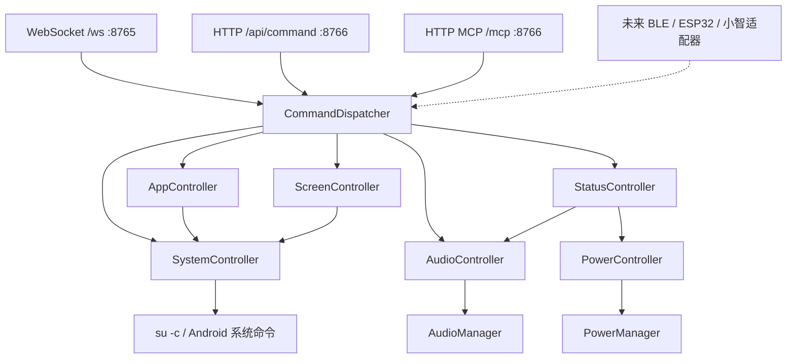

# 架构说明

AndroidPhonePilot 将 Root Android 手机作为统一控制主机。协议层负责请求接收与认证，核心层负责动作分发，控制器负责调用 Android API 或 Root shell，避免各入口重复实现动作。

## 当前模块与职责

| 模块 | 当前职责 |
| --- | --- |
| MainActivity | 实时状态首页、主题、连接设置、令牌与示例复制 |
| DeviceStatus | 内存、CPU、电池、网络和接口地址的共享采样 |
| RuntimeState | 实际服务与端口状态、连接数、统一令牌及监听设置 |
| PilotService | 前台通知与生命周期；承载两个网络入口 |
| CommandDispatcher | 所有入口共享的动作名称、参数路由与控制器调用 |
| AppController | 校验包名，通过 Root shell 启动应用；提供常用应用别名 |
| ScreenController | 发送明确的唤醒/休眠按键事件 |
| AudioController | 通过 AudioManager 控制媒体音量 |
| SystemController | 执行 su -c、等待超时、返回退出码与限长输出 |
| PowerController | 读取屏幕交互状态；当前不提供重启/关机动作 |
| StatusController | 聚合机型、屏幕交互状态及媒体音量 |
| BootReceiver | 接收开机广播，尝试启动前台服务 |

实现文件位于 `app/src/main/java/dev/phonepilot/`：`Core.kt` 为核心控制层，`PilotService.kt` 为入口及应用生命周期层。当前以单 app 模块交付；类职责已划分，尚未拆成独立 Gradle 模块。

## 请求路径

WebSocket 接收 `action` 与 `args`；MCP 的 `tools/call` 将 `name` 与 `arguments` 映射到同一个 `execute`。例如两种入口的 volume_set 最终均调用 AudioController.set。MCP 提供 initialize、ping、tools/list、tools/call，当前采用 HTTP JSON 响应，尚未完成完整客户端互操作验证。

控制端默认监听 127.0.0.1；用户可主动开启局域网监听。三个入口均校验同一 Bearer token，WebSocket 仅接受已通过认证连接的消息。首版令牌具有全部动作权限，包含 Root shell。当前支持手动开启可信局域网直连，尚无 TLS 网关、权限分级或令牌轮换界面。

## 常驻与扩展

前台服务使用通知、START_STICKY 与开机广播；它仍是 Android 应用进程，不是独立的 Magisk 守护进程。强停、厂商省电策略和系统限制可能影响恢复，必须真机验证。

未来蓝牙按键适配器应将按键映射为核心动作；ESP32/小智适配器应完成认证、连接与协议转换，再调用同一核心入口。虚线模块尚未实现。远程接入前应补充加密传输、权限控制、调用审计与请求资源限制。

## 设计来源与实现边界

感谢 [DroidBridge](https://github.com/zephyr7030/DroidBridge) 对 Android 设备端 MCP、Root 控制与常驻服务方向的探索。本项目按需求参考这一方向，当前 Kotlin 控制层与协议适配代码独立编写，未复制或移植其源码，也未包含其 Root edition、隧道或自动化运行时。当前仓库不是 DroidBridge 的 Fork，不表示已经具备其功能覆盖范围。

构建通过与真机功能通过分开记录；当前已通过模拟器入口集成检查，尚未连接真机。来源及依赖见 [ACKNOWLEDGEMENTS.md](../ACKNOWLEDGEMENTS.md)。
